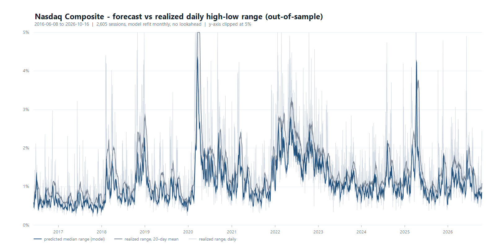

# Nasdaq Range Forecaster

Calibrated **daily high/low prediction bands** for NQ, ES and the Nasdaq Composite —
built from free public data, validated walk-forward, and shipped as a TradingView indicator.

It does not call the exact high. It tells you **where the day's extremes are likely to sit,
with stated odds** — and it shows its own hit-rate on your chart so you can check it.



## Headline results

Out-of-sample, 2016-10-18 → 2026-10-16, 2,513 sessions, monthly refit, no lookahead:

| Metric | Result |
|---|---|
| 80% band contains the actual **high** | **80.0%** |
| 80% band contains the actual **low** | **80.5%** |
| Median error on the high | **0.28%** of price (p90 0.86%) |
| Median error on the low | **0.31%** of price |
| vs naive "yesterday's range" | **−31% / −28% MAE** |
| vs EWMA volatility (RiskMetrics) | −5% / −7% MAE |
| Beat naive in every single year | **11 / 11** (29–35% each year) |

The band calibration is the point: an "80% band" really does contain the truth four times
out of five. That is a quotable probability, not a guess dressed up as one.

## Quickstart

Requires Node 18+ (uses native `fetch`). No dependencies, no API keys.

```bash
node src/build_all_datasets.js   # download the three datasets
node src/range_forecast.js       # fit, validate, print the next-session bands
node src/backtest_10y.js         # benchmark comparison + year-by-year table
node src/pine_rehearsal.js       # verify the TradingView port against the research model
```

## TradingView

Paste [`pine/nasdaq_range_forecaster.pine`](pine/nasdaq_range_forecaster.pine) into the Pine
Editor on a **daily** chart of `NQ1!` or `ES1!`. Full guide in
[`docs/06-tradingview.md`](docs/06-tradingview.md).

The script auto-detects the instrument, draws 10/50/90 percentile bands for the high and low,
and shows a live calibration table so you can verify the hit-rate yourself.

## Repository map

```
├── pine/        TradingView indicator (Pine v5)
├── src/         data pipeline, model, backtests, chart renderers
├── data/        the datasets and every out-of-sample forecast
├── charts/      generated figures
└── docs/        the full write-up
```

| Path | What it is |
|---|---|
| [`docs/00-process.md`](docs/00-process.md) | **How this was built**, step by step, including the dead ends |
| [`docs/01-methodology.md`](docs/01-methodology.md) | The model, the equations, why the bands calibrate |
| [`docs/02-data.md`](docs/02-data.md) | Every data source, coverage, sessions, provenance |
| [`docs/03-backtests.md`](docs/03-backtests.md) | All backtest results |
| [`docs/04-what-it-shows.md`](docs/04-what-it-shows.md) | How to read it and what to use it for |
| [`docs/05-limitations.md`](docs/05-limitations.md) | The measured accuracy ceiling — and the 90% question |
| [`docs/06-tradingview.md`](docs/06-tradingview.md) | Install and verify the indicator |
| [`docs/07-futures-and-24y.md`](docs/07-futures-and-24y.md) | 24 years of history, NQ/ES, session pitfalls |

## How it works, in three sentences

Two log-linear regressions predict the **upside excursion** `(high − open)/open` and the
**downside excursion** `(open − low)/open` from trailing range and realised volatility.
Bands come from the empirical quantiles of the model's own recent out-of-sample errors, so
their width adapts to the volatility regime without any external data.
Everything is scored strictly walk-forward: the model never sees a bar it is predicting.

## Data

All free, all reproducible:

| Dataset | Coverage | Source |
|---|---|---|
| Nasdaq Composite (^IXIC) | 6,255 sessions, 2002-01-01 → 2026-10-16 | `api.nasdaq.com` |
| NQ futures (Nasdaq-100 E-mini) | 2,199 sessions, 2018-04-24 → 2026-10-19 | Sina global futures |
| ES futures (S&P 500 E-mini) | 2,402 sessions, 2016-10-21 → 2026-10-19 | Sina global futures |

Provenance, session definitions and the three corrected sessions are documented in
[`docs/02-data.md`](docs/02-data.md).

## What this is not

- **Not a direction model.** It cannot tell you whether the high comes before the low.
- **Not a trading system.** No entries, no execution, no risk engine.
- **Not a high/low oracle.** Median error is ~0.3% of price, and the position of the extreme
  inside the day's range is close to random. [`docs/05-limitations.md`](docs/05-limitations.md)
  measures how close to the ceiling this sits — within 11% of an oracle handed the day's
  exact range in advance.

## Rebuilding

Everything is reproducible from scratch — no keys, no paid data:

```bash
node src/build_all_datasets.js   # re-pull the three datasets
node src/range_forecast.js       # refit, revalidate, print next-session bands
node src/fit_coefficients.js     # regenerate the Pine constants if you change the model
```

## License

MIT — see [LICENSE](LICENSE).
