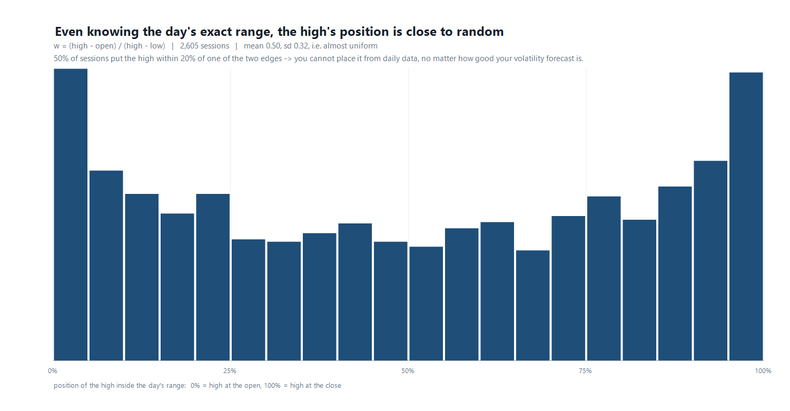

# How this was built — the process, including the dead ends

This is the actual sequence of decisions, with the measurement that settled each one.
Every number quoted here is reproducible with a script in [`../src`](../src).

---

## 1. The starting point was a dead end

The original question was how to sign up to bloomberg.com to download Nasdaq data. Bloomberg
rejects consumer email domains, and — more importantly — a free bloomberg.com account gives
quotes and headlines, not bulk historical OHLC. That access sits behind a terminal or a data
licence worth five figures a year.

Conclusion: **abandon Bloomberg, build the dataset from free sources.** This turned out to be
the right call for reasons that only became clear later (§5).

## 2. Data acquisition: three sources worked, four did not

| Source | Result |
|---|---|
| Yahoo Finance (`query1.finance.yahoo.com`) | **blocked** from this network (regional) |
| Stooq (`stooq.com/q/d/l/`) | **403** — rejects the client |
| Eastmoney (`push2his.eastmoney.com`) | worked once, then rate-limited into permanent failure |
| Tencent (`web.ifzq.gtimg.cn`) | **worked** — 640-bar pages, full history |
| Nasdaq (`api.nasdaq.com`) | **worked** — authoritative, back to 2002 |
| Sina (`stock2.finance.sina.com.cn`) | **worked** — NQ and ES futures |
| Bloomberg | no bulk access without entitlement |

Two practical notes:

- Shell networking was blocked in this environment; only the harness's HTTP layer worked. The
  workaround that unblocked everything was discovering that **Node's `fetch` had working
  egress**, which allowed proper pagination and retries instead of one-shot fetches.
- Tencent caps a kline response at 640 rows, so history has to be paged backwards by date
  range. That is what [`../src/refresh_ixic.js`](../src/refresh_ixic.js) does.

## 3. First model: predict the excursions, not the price

The obvious approach — regress the high level on past highs — is a trap: the index rose from
4,200 to 27,700 over the sample, so any level-based model is dominated by trend. The model
instead predicts **percentage excursions from the session open**:

```
u = (high − open) / open        upside excursion
d = (open − low)  / open        downside excursion
```

These are scale-free, roughly log-normal, and independent of the index level. Each is modelled
with a log-linear regression on five features computed strictly from prior bars:

```
1, ln(mean daily range over 5), ln(... 20), ln(... 60), ln(20-day realised vol)
```

Refit every 21 trading days on an expanding window.

## 4. Calibration: the part that makes it usable

A point forecast ("the high will be 26,279") is close to worthless, because the honest
uncertainty around it is large. What makes the tool usable is the **band**.

Bands are built from the empirical quantiles of the model's own recent out-of-sample errors —
the last 500 residuals, recomputed as they arrive. That is why an 80% band really covers 80%:
it is not an assumption about normality, it is measured.

The first version of this had a bug worth recording: percentile direction for the downside was
inverted, so the low band was an empty interval and coverage read **0.0%**. The fix is one
line, but it is the kind of bug that silently produces a confident-looking chart.

## 5. The ceiling — the most important finding

Three separate experiments converged on the same result: **no amount of daily-frequency data
improves this forecast.**

**5a. More history does not help.** Trained on 24 years vs 10 years, scored on the same window:

| Training history | MAE high | MAE low | 80% coverage |
|---|---|---|---|
| 24 years (from 2002) | 55 | 67 | 79.9% |
| 10 years (from 2015) | 55 | 68 | 79.8% |

Identical. ([`03-backtests.md`](03-backtests.md))

**5b. Better volatility estimators do not help.** Parkinson, Garman-Klass and Yang-Zhang
extract far more information from the same OHLC than close-to-close vol:

| Estimator | MAE high |
|---|---|
| close-to-close | 54.8 |
| Parkinson | 54.8 |
| Garman-Klass | 54.8 |
| Yang-Zhang | 54.9 |

Zero. The volatility input is saturated. ([`../src/vol_estimator_test.js`](../src/vol_estimator_test.js))

**5c. Why: the extreme's position inside the range is unknowable.**
Let `w = (high − open)/(high − low)`. If you knew the day's exact range, `w` would be all that
is left to guess. Measured: mean 0.50, **sd 0.32**, essentially uniform, and **50% of sessions
put the high within 20% of one of the two edges**.



An oracle handed the exact range and placing the high at its median position scores **0.310%**
median error. The model scores **0.280%** — it is already better than that oracle, because it
also uses the open. The residual error is not missing information; it is the unknowable path.

This is why every later "add this data" request got the same answer.

## 6. Futures: NQ and ES are not the index

The indicator is meant to trade NQ/ES, so it was rebuilt on their own history. Two findings:

- Correlation of daily returns: NQ↔IXIC **0.945**, ES↔NQ 0.929, ES↔IXIC 0.898. Close in
  direction, different in points.
- The free futures bars are **24-hour Globex sessions**, not RTH. Mean range NQ 1.98% vs index
  1.44%, and the gap from prior close collapses to 0.14% because the overnight move is inside
  the bar. That makes NQ a harder target (0.43% median error vs 0.29%) and means a day trader
  using RTH bars is asking a different question.

## 7. Porting to TradingView

Pine cannot call external data or fit regressions cheaply, so the port splits the work:

| Part | Runs |
|---|---|
| Regression coefficients | fitted offline on full history, pasted as constants |
| Features | live in Pine |
| Band width (residual quantiles) | live in Pine, recomputed every 21 bars |

Static coefficients are safe *because of §5a* — the fit window does not matter.

Since Pine cannot be compiled in this environment, the script's logic was reimplemented in
JavaScript ([`../src/pine_rehearsal.js`](../src/pine_rehearsal.js)) and checked against the
research model: IXIC 54.8 vs 55 MAE, NQ 95.6 vs 98, ES 19.5 vs 21, with coverage 79–82%. The
port is faithful.

## 8. What would actually move the number

Only **intraday data**, because it converts forecasting into nowcasting: by 11:00 most of the
day's range has already happened. Everything else — options gamma, implied vol, breadth,
cross-asset, positioning — is either already priced in or helps only marginally on event days.
The full ranking with expected gains is in [`05-limitations.md`](05-limitations.md).

## Timeline of decisions

| # | Decision | Evidence |
|---|---|---|
| 1 | Drop Bloomberg, use free feeds | no bulk access without entitlement |
| 2 | Model excursions, not levels | 4,200 → 27,700 index drift |
| 3 | Add probability bands | point forecasts are not actionable alone |
| 4 | Walk-forward everything | avoid lookahead, publish honest coverage |
| 5 | Accept the daily ceiling | 3 independent experiments (§5) |
| 6 | Port to Pine with static coefficients | 24y vs 10y fits are identical |
