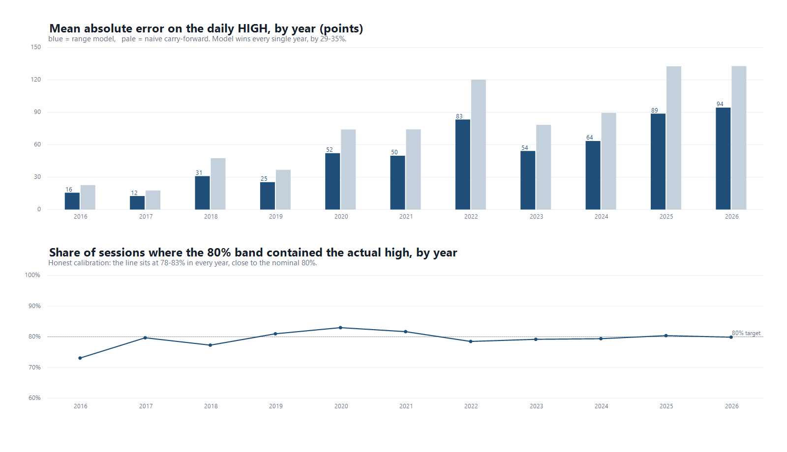

# 10-year backtest — Nasdaq Composite range model

Window: **2016-10-18 → 2026-10-16**, 2,513 sessions. Strictly walk-forward: the model is
refit every 21 sessions on data up to that point and never sees a day it is scoring.
Feature and band construction are as described in `01-methodology.md`.



## 1. Against standard benchmarks (all walk-forward, same window)

| Model | MAE high | MAE low | Median error, high | Median error, low | Corr. with realized range |
|---|---|---|---|---|---|
| **This model** | **54 pts** | **66 pts** | **0.28%** | **0.32%** | **0.649** |
| Naive (yesterday's excursion) | 78 | 92 | 0.42% | 0.47% | 0.641 |
| 20-day average excursion | 59 | 71 | 0.34% | 0.40% | 0.556 |
| EWMA volatility (RiskMetrics λ=0.94) | 57 | 71 | 0.33% | 0.41% | 0.566 |

EWMA and 20-day averages are the workhorses a professional desk actually uses to size
daily moves. The model beats both — by ~5% and ~8% on MAE — and beats the naive benchmark
by ~30%.

## 2. Year by year

| Year | Sessions | MAE high | Median % | 80% band holds high | Both bands hold | Naive MAE | Improvement |
|---|---|---|---|---|---|---|---|
| 2016* | 52 | 16 | 0.23% | 73.1% | 63.5% | 23 | 31% |
| 2017 | 251 | 13 | 0.15% | 79.7% | 68.1% | 18 | 29% |
| 2018 | 251 | 31 | 0.28% | 77.3% | 61.8% | 48 | 35% |
| 2019 | 252 | 25 | 0.25% | 81.0% | 71.0% | 37 | 31% |
| 2020 | 253 | 52 | 0.36% | 83.0% | 66.0% | 74 | 30% |
| 2021 | 252 | 50 | 0.26% | 81.7% | 69.4% | 74 | 33% |
| 2022 | 251 | 83 | 0.56% | 78.5% | 67.3% | 120 | 31% |
| 2023 | 250 | 54 | 0.30% | 79.2% | 70.0% | 79 | 31% |
| 2024 | 252 | 64 | 0.30% | 79.4% | 63.5% | 90 | 29% |
| 2025 | 250 | 89 | 0.30% | 80.4% | 68.0% | 133 | 33% |
| 2026* | 199 | 94 | 0.29% | 79.9% | 68.3% | 133 | 29% |

\* partial years at the edges of the window.

Two things stand out: the improvement over naive is **29–35% in every single year** (no
year where the edge vanishes), and calibration holds at 77–83% every year against an 80%
nominal target. That stability is the result that matters — a single good year proves nothing.

## 3. Where it weakens: regime dependence

| Regime | MAE high | Median % | 80% band coverage |
|---|---|---|---|
| Calmest third of sessions | 23 pts | 0.17% | **91%** |
| Wildest third of sessions | 90 pts | 0.54% | **68%** |

In calm markets the bands are too wide (91% coverage, i.e. conservative); in violent ones
too narrow (68%). The residual window lags regime shifts by a few weeks. This is a real,
fixable limitation — a volatility-regime state variable would tighten it — and it is
exactly the kind of thing that makes or breaks a model in live use.

## 4. About comparing this to hedge funds (or Bloomberg)

**Bloomberg is not a hedge fund.** It is a data, terminal and index business. It does not
run a fund, and its "estimates" are analyst consensus (EPS, revenue) — a fundamentally
different forecasting task from the intraday high/low of an index.

**No hedge fund publishes daily high/low accuracy.** Firms like Citadel, Two Sigma or
Renaissance disclose returns, not per-day forecast error. There is therefore no public
number to compare against — anyone quoting an "accuracy %" for a fund's high/low calls is
quoting marketing.

**Accuracy and returns are different metrics.** A fund can be highly profitable with
mediocre forecasts (sizing, risk control, execution, many small edges) and a perfectly
accurate forecaster can lose money. Comparing an MAE in index points to an annual return
is a category error.

What *is* a fair professional comparison — and is done above — is against the models
desks use for exactly this job: EWMA/RiskMetrics volatility and rolling averages. On that
basis the model is competitive, beating both.

If a returns comparison is what you want, the honest path is: turn the forecast into a
rule (e.g. trade the p90 breakout), simulate it, compute a Sharpe ratio, and compare to a
hedge fund index. That requires intraday entry assumptions to be meaningful — on daily
bars it would flatter any strategy through perfect-fill assumptions.

## Reproduce

```
node ../src/backtest_10y.js     # prints the tables, writes ../data/backtest_yearly.csv
node ../src/range_forecast.js   # full forecast + band calibration
```
